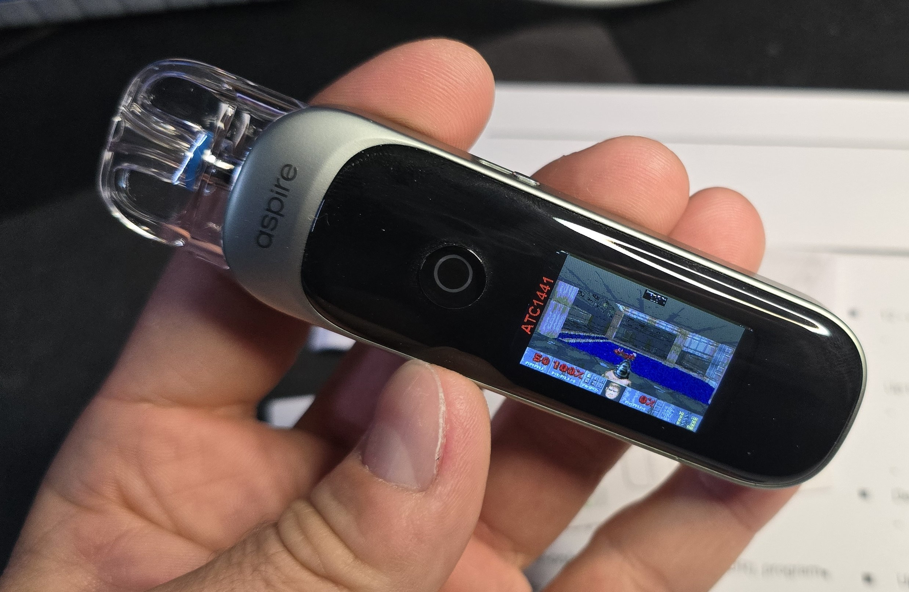
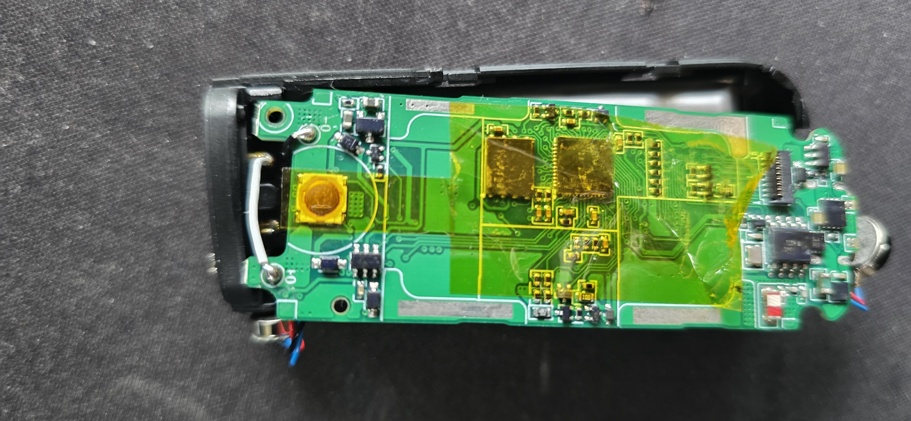
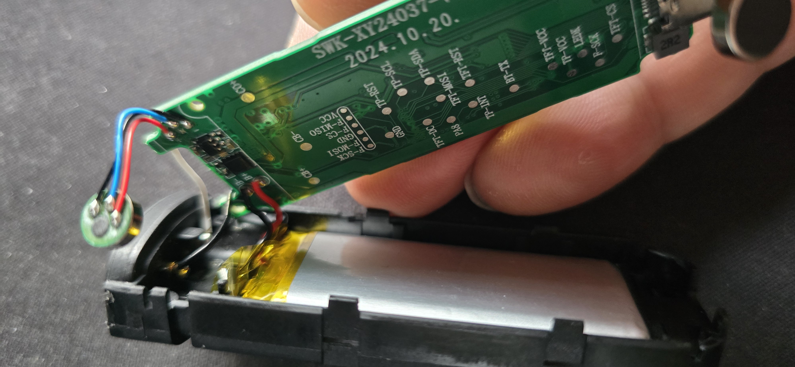

# Custom firmware for the Aspire PIXO Vape

This repo is made together with this explanation video:(click on the image)

[https://www.youtube.com/watch?v=rVsvtEj9iqE](https://www.youtube.com/watch?v=rVsvtEj9iqE)

The PIXO Aspire is a ~30€ VAPE which got quite some power in terms of Computing hardware

While it can not directly Play DOOM by utilizing the USB Connection and its Display we can use a screen share cheat to hack DOOM onto the Vape^^ This does basically allow to run anything on it like videos etc.

Find the Custom firmware and the WebTool in this Repo

# WebTool

Find the Screen Share WebSerial Tool here:

[VapeCloudStreamer.html](VapeCloudStreamer.html)

# Firmware Backups

You can find firmware dumps [here](Firmware_Files)

# Hardware Infos

Inside we can find

- Puxa PY32F403XC 64KB RAM 256KB Flash ARM
- External 16MB SPI Flash
- BLE Chip
- Battery
- LCD 323x173 Pixel
- Heating Coil
- Hardware Watchdog on PC6
- Vape Mic
- Vibration Motor
- Battery Charger
- more...

